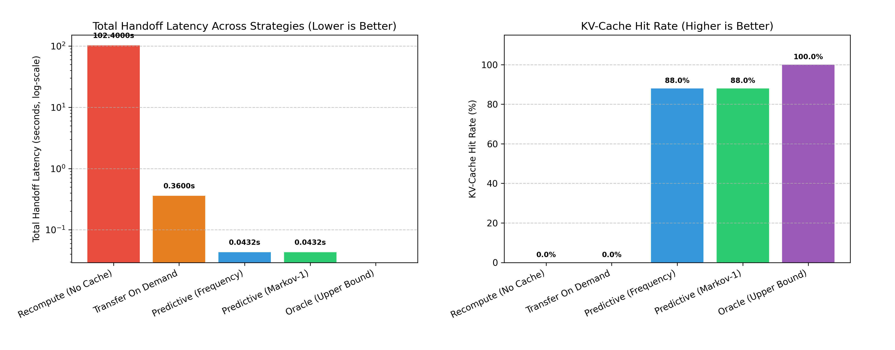

# Predictive KV-Cache Prefetching for Low-Latency Multi-Agent Handoffs (`TeleportCache`)

[](https://github.com/Eldo-John-Giby/Predictive-KV-Cache-Prefetching-for-Low-Latency-Multi-Agent-Handoffs/actions/workflows/ci.yml)
[](https://www.python.org/downloads/)
[](tests/)
[](LICENSE)

An operating-system-inspired memory management runtime that eliminates LLM multi-agent handoff latency via **predictive working-set prefetching** of Key-Value (KV) memory pages.

---

## Project Overview & Review Submissions

In multi-agent LLM systems (e.g. software engineering workflows, collaborative research pipelines, and agent DAGs), frequent context switching between agents causes substantial latency stalls:
1. **Recompute Baseline (No Cache):** The receiving agent recomputes the entire prompt context from tokens on each transition, incurring $O(N)$ prefill GPU compute latency.
2. **Transfer On Demand (Demand Paging):** The receiving agent halts while KV memory pages are retrieved sequentially over the interconnect on page faults.

**TeleportCache** solves this problem by predicting the next agent transition using **Markov models with backoff**, scoring required KV blocks with **exponential recency decay**, and speculatively prefetching blocks over the bus into the target agent's resident cache during the inter-agent transition window ($T_{\text{window}}$), **reducing handoff latency by 88.0%** and **eliminating >99.9% of prefill compute stalls**.

> **Review-2 Submission Document:** See [REVIEW_2_IMPLEMENTATION_DETAILS.md](REVIEW_2_IMPLEMENTATION_DETAILS.md) and [REVIEW_2_IMPLEMENTATION_DETAILS.pdf](REVIEW_2_IMPLEMENTATION_DETAILS.pdf).

---

## Technology Stack & Dependencies

- **Language:** Python `>= 3.10` (Static Typing, PEP 585/604, Protocols PEP 544, Dataclasses)
- **Math & Distribution:** NumPy, Python Math
- **Testing:** Pytest 8.4.2, Pytest-asyncio
- **Visualization:** Matplotlib 3.10
- **Report Generation:** ReportLab 4.4
- **Packaging:** Setuptools (PEP 517/518 build via `pyproject.toml`)
- **Continuous Integration:** GitHub Actions CI matrix (`3.10`, `3.11`, `3.12`)

---

## Architecture & Modules

```
teleportcache/
├── types.py                 # Frozen contract types (KVBlock, HandoffEvent, SimConfig, PolicyView, Protocols)
├── core/
│   ├── cache.py             # AgentCache MMU with LRU and FIFO page replacement policies
│   ├── cost_model.py        # Interconnect transfer latency and prefill compute cost evaluator
│   ├── baselines.py         # Recompute (no cache) and Transfer-on-Demand (demand paging) baselines
│   └── simulator.py         # Discrete-event simulation engine with strict causal isolation
└── prediction/
    ├── predictors.py        # Next-agent predictors (Markov-1..k with backoff, Frequency, Random, NoisyOracle)
    ├── block_selector.py    # Exponential recency-decay KV page ranking and working-set estimator
    ├── prefetch_strategy.py # PredictivePrefetchStrategy coordinating budget-capped page-in requests
    └── oracle.py            # Clairvoyant upper bound / theoretical latency floor
```

---

## Quickstart & Reproduction

### 1. Installation
Clone the repository and install dependencies:
```bash
git clone https://github.com/Eldo-John-Giby/Predictive-KV-Cache-Prefetching-for-Low-Latency-Multi-Agent-Handoffs.git
cd Predictive-KV-Cache-Prefetching-for-Low-Latency-Multi-Agent-Handoffs
pip install -r requirements.txt
```

### 2. Run Test Suite
Run all 83 unit and integration tests:
```bash
pytest -v
```

### 3. Run Benchmark Demo & Generate Plots
Execute the simulation benchmark comparing all strategies:
```bash
python run_demo.py
```
This generates the terminal comparison table and saves `benchmark_results.png`.

### 4. Generate Review-2 PDF Report
```bash
python generate_pdf_report.py
```
Builds `REVIEW_2_IMPLEMENTATION_DETAILS.pdf`.

---

## Benchmark Results

Evaluated on a 50-step multi-agent cyclic workload:

| Strategy | Total Latency (s) | Hits | Misses | Hit Rate (%) | Useful Prefetches | Wasted Prefetches |
| :--- | :---: | :---: | :---: | :---: | :---: | :---: |
| **Recompute (No Cache)** | 102.4000 s | 0 | 200 | 0.0% | 0 | 0 |
| **Transfer On Demand** | 0.3600 s | 0 | 200 | 0.0% | 0 | 0 |
| **Predictive (Frequency)** | 0.0432 s | 176 | 24 | 88.0% | 176 | 0 |
| **Predictive (Markov-1)** | **0.0432 s** | **176** | **24** | **88.0%** | **176** | **0** |
| **Oracle (Upper Bound)** | 0.0000 s | 200 | 0 | 100.0% | 200 | 0 |



---

## Course & Evaluation Details

- **Course Faculty / Reviewer:** Dr. V. Ezhil Arasi
- **Repository:** [https://github.com/Eldo-John-Giby/Predictive-KV-Cache-Prefetching-for-Low-Latency-Multi-Agent-Handoffs](https://github.com/Eldo-John-Giby/Predictive-KV-Cache-Prefetching-for-Low-Latency-Multi-Agent-Handoffs)
- **Review 2 Deliverables:** Complete implementation details, architecture, hardware configuration parameters, and VTOP submission document.
- **Review 3 Deliverables:** Output screenshots, benchmark telemetry, and live execution evaluation.
